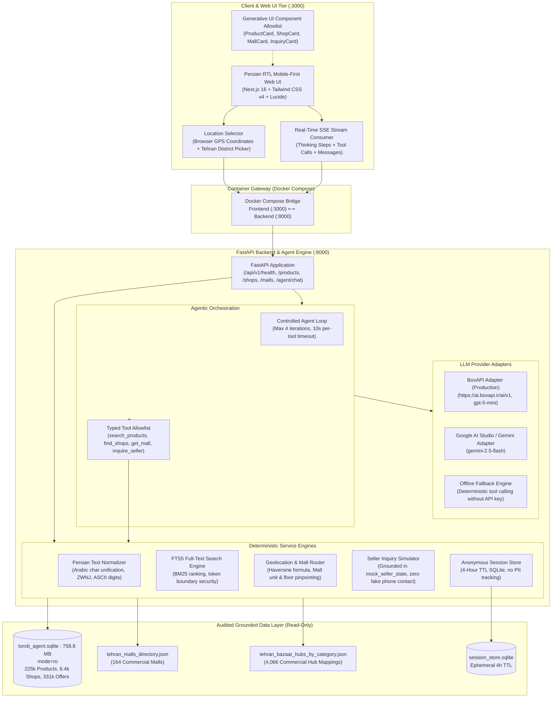

# Torob In-Person Shopping Assistant

[](https://fastapi.tiangolo.com)
[](https://nextjs.org)
[](https://tailwindcss.com)
[](https://sqlite.org)
[](https://liara.ir)
[]()
[]()

> An intelligent hybrid shopping assistant (**Deterministic Retrieval + Agentic LLM**) for in-person physical buyers in Tehran, strictly grounded in Torob's audited catalog of **225,903 products**, **6,476 physical shops**, **331,506 offers**, and **164 commercial shopping malls**.

[**نسخه فارسی مستندات (Persian Documentation)**](README_FA.md) • [**راهنمای استقرار در لیارا (Liara Guide)**](docs/LIARA_DEPLOYMENT_GUIDE.md) • [**متن و ویدیوی چالش (Challenge Pitch)**](docs/intro-text.md) • [**ماتریس پذیرش (Acceptance Matrix)**](docs/ACCEPTANCE_MATRIX.md)

---

## 1. System Architecture

The assistant employs a modular, two-tier hybrid architecture that decouples deterministic catalog retrieval, ranking, and navigation from agentic LLM reasoning and real-time Server-Sent Events (SSE) streaming.



---

## 2. Core Capabilities & In-Person Shopping Journey

The assistant solves the exact **4-step buyer journey** and **5 major pain points** outlined by the Torob Challenge:

```
[ Step 1: Need Discovery & Product Comparison ]
  ├── Natural Persian query or category chip (FTS5 + Persian normalizer)
  ├── Honest product specs, model comparison & market price ranges
  └── Zero hallucination (strictly bounded to 225,903 audited products)

[ Step 2: Physical Store Discovery & Geolocation ]
  ├── Match physical shops in Tehran carrying the exact selected product
  ├── Filter by Tehran area (browser GPS coordinates or manual neighborhood picker)
  ├── Calculate exact physical distance (Haversine formula)
  └── Strict Torob-Pay installment filter (only verified has_installment == 1)

[ Step 3: Store Comparison & In-Mall Indoor Navigation ]
  ├── Side-by-side store comparison (price, distance, hours, installment, freshness)
  ├── Indoor mall navigation for 164 Tehran malls:
  │     Mall Name ──> Floor ──> Unit Number ──> Corridor Walking Directions
  └── Transit guidance: nearest Tehran Metro station and parking availability

[ Step 4: Seller Inquiry Simulation & Live Alternatives ]
  ├── In-app simulated seller inquiry (stock confirmation & live price update)
  ├── Zero contact risk: synthetic challenge phone numbers are 100% stripped
  └── Data-backed alternatives:
        ├── Nearby shops inside the same mall or within 1 km
        └── Traditional Tehran category bazaar hubs (e.g., Lalezar, Aladdin, Shoush)
```

### Detailed Breakdown of Capabilities:

1. **Deterministic Persian Catalog Search (Independent of LLM):**
   - Built on SQLite FTS5 with custom Persian text normalization: unifies Arabic/Persian letter variants (`ي`/`ي` $\to$ `ی`, `ك` $\to$ `ک`), converts Persian and Arabic numerals to ASCII, cleans Zero-Width Non-Joiners (ZWNJ), and strips conversational query prefixes.
   - Products are ranked by relevance, catalog completeness, and verified offer density.

2. **Tehran Physical Store Discovery & Multi-Criteria Ranking:**
   - Filters physical stores carrying genuine offers from the 331,506 verified catalog records.
   - Computes real-time Haversine physical distance to the user's location.
   - Verifies operational status against documented business hours.
   - Enforces strict installment eligibility: only stores with verified Torob-Pay / Credit providers (`has_installment == 1`) qualify.

3. **Indoor Mall Navigation (164 Malls) & Tehran Commercial Hubs:**
   - Solves the common physical shopper problem of locating a shop inside large commercial centers.
   - Provides exact Floor, Commercial Plak / Unit Number, and corridor orientation hints for 3,839 stores located inside malls like Charsou, Aladdin, Paytakht, Kourosh, and Iran Mall.
   - Recommends specialized traditional Tehran bazaar hubs based on 4,066 categorized market mappings.

4. **Truthful In-App Seller Inquiry Simulation:**
   - Real-world physical shoppers face outdated prices or out-of-stock items. The simulation queries the store's verified reliability profile (`mock_seller_state_json`) to disclose whether the item is in stock, requires physical inspection, or has undergone a price change.
   - **Data Truthfulness Guarantee:** The challenge dataset contains synthetic phone numbers. The application **never** surfaces these as clickable `tel:` links, SMS buttons, or real seller communication channels.

5. **Streaming Agent with Generative UI Allowlist:**
   - Streams reasoning steps (`thinking`), tool execution notices (`tool_start`, `tool_done`), and markdown output in real time via Server-Sent Events (SSE).
   - Generative UI is restricted to a strict allowlist of pre-compiled, schema-validated React components. No arbitrary HTML, code execution, or script injection is permitted.

6. **Privacy-Preserving Ephemeral Sessions:**
   - Anonymous user state (selected products, active filters, conversation context) is stored in a separate SQLite database (`session_store.sqlite`) with a 4-hour sliding Time-To-Live (TTL). No personal identifying information (PII) or user accounts are created.

---

## 3. Truthfulness Invariants & Security Guardrails

| Guardrail / Invariant | Implementation Mechanism | Enforcement Level |
|---|---|---|
| **Zero Data Fabrication** | All products, offers, specs, prices, and malls are queried exclusively from `torob_agent.sqlite` and directory JSONs. | **Strictly Enforced** |
| **Synthetic Phone Number Protection** | Synthetic challenge phone numbers are 100% stripped from API responses and UI views; no `tel:` links or SMS actions exist. | **Hard Block** |
| **Shop Identity Honesty** | Synthetic shop names are clearly badged as *"فروشگاه محلی (هویت در ترب تأیید نشده)"* unless belonging to the 112 audited verified shops. | **Strictly Enforced** |
| **Read-Only Database Isolation** | Source dataset SQLite is opened with strict URI `file:path?mode=ro`, guaranteeing the immutable integrity of baseline data. | **OS / SQLite Driver** |
| **Generative UI Component Sandboxing** | The LLM may only instruct rendering from a strict allowlist of 8 React components (`ProductCard`, `ShopCard`, `MallCard`, etc.). Arbitrary code is rejected. | **Schema Validator (Zod)** |
| **Privacy & TTL Expiration** | Anonymous sessions expire after 4 hours of inactivity; browser coordinates are never persisted to disk or external storage. | **Automated TTL Reaper** |
| **Bounded Agent Loop Execution** | The agentic loop is bounded to a maximum of 4 tool iterations and an 8-second timeout per tool call, preventing runaway executions. | **FastAPI Async Engine** |

---

## 4. Challenge Capability & Feasibility Matrix

| Capability | Challenge Dataset Support | System Implementation | Safety & Invariant Status |
|---|---|---|---|
| **Persian Product Search** | 225,903 products in `products_fts` | SQLite FTS5 + Persian Normalizer | Supported (Deterministic, No LLM dependency) |
| **English & Alias Search** | Cleaned brand & model tokens | FTS5 multi-column matching | Supported (Deterministic) |
| **Tehran Store Matching** | 6,476 shops & 331,506 offers | SQL inner join on verified offers | Grounded (Zero synthetic store associations) |
| **Distance & Geolocation** | Lat/Lon coordinates for Tehran | Haversine distance calculator | Supported (Browser GPS or Manual District) |
| **Torob-Pay Installments** | 266 confirmed installment shops | Strict SQL filter `has_installment == 1` | Verified (Unknown/unconfirmed never qualifies) |
| **Indoor Mall Navigation** | 164 commercial centers in directory | Floor, unit & corridor hints | Audited directory (164 malls, 3.8k shops) |
| **Bazaar Hub Fallback** | 4,066 category bazaar mappings | Bounded hub recommendation tool | Grounded in Tehran commercial history |
| **Seller Stock Inquiry** | Synthetic historical profile | In-app simulated dialogue | Simulated (Zero fake phone contact) |
| **Agent Real-Time Streaming** | BoxAPI / Gemini / Offline Mock | Server-Sent Events (SSE) | Validated (Includes thinking & tool events) |
| **Generative UI Rendering** | Allowlisted UI components | Native Tailwind & React components | Sandboxed (Zero arbitrary code execution) |
| **Anonymous Session Store** | Ephemeral SQLite storage | 4-Hour TTL Session Service | Anonymous (No account, no tracking) |
| **Liara Cloud Deployment** | Dockerfile & Docker Compose | Multi-container architecture | Cloud-Ready (Port 3000 Web, Port 8000 API) |

---

## 5. Quick Start

### Prerequisites
- **Python 3.10+** or **3.11**
- **Node.js 18+** or **20+**
- **pnpm 9+** (`npm install -g pnpm`)
- *(Optional)* **Docker & Docker Compose**

---

### Option A: Local Development Setup

#### 1. Clone the repository
```bash
git clone https://github.com/amir-mostafa-hs/aps-torob-ai-agent.git
cd aps-torob-ai-agent
```

#### 2. Configure Environment Variables
```bash
cp .env.example .env
```
*(The system works 100% offline using the built-in deterministic Mock LLM even without providing LLM API keys.)*

#### 3. Start the FastAPI Backend
```bash
cd backend

# Create and activate virtual environment
python -m venv .venv
# On Windows:
.venv\Scripts\activate
# On Linux/macOS:
source .venv/bin/activate

# Install dependencies
pip install -r requirements.txt

# Run FastAPI server on port 8000
python -m uvicorn app.main:app --host 127.0.0.1 --port 8000 --reload
```

#### 4. Start the Next.js Frontend
In a new terminal:
```bash
cd frontend

# Install dependencies
pnpm install

# Run Next.js development server on port 3000
pnpm dev
```

---

### Option B: Docker Compose Setup

Run the entire multi-tier stack with a single command:
```bash
docker compose up -d --build
```

### Access URLs:
- **Web Application:** [http://localhost:3000](http://localhost:3000)
- **Interactive Swagger API Documentation:** [http://localhost:8000/docs](http://localhost:8000/docs)
- **Backend Readiness Probe:** [http://localhost:8000/api/v1/health](http://localhost:8000/api/v1/health)

---

## 6. End-to-End User Experience & API Guide

### Interactive Web Experience:
1. **Homepage:** Persian-first interface with search bar, quick query suggestions (`سامسونگ S24`, `آیفون 13`, `پاساژ علاءالدین`), and district selector.
2. **Product Details & Comparison:** Select any product to inspect market price boundaries, specs, and open the comparison modal.
3. **Physical Store View:** View physical shops carrying the product sorted by price or distance, filter by Torob-Pay installment eligibility, and inspect indoor floor/unit directions.
4. **Simulated Seller Inquiry:** Trigger a simulated inquiry on any store to verify live availability and updated prices.
5. **AI Assistant Drawer:** Open the floating conversational assistant at any point. The agent reasons aloud, invokes catalog tools, and renders interactive cards.

### REST API Endpoints Overview:

| Method | Endpoint | Description |
|---|---|---|
| `GET` | `/api/v1/health` | Health probe reporting database connectivity and row counts |
| `GET` | `/api/v1/products/search?q={query}` | Deterministic Persian full-text search with pagination |
| `GET` | `/api/v1/products/{product_id}` | Detailed product specifications and buying guide |
| `GET` | `/api/v1/products/{product_id}/shops` | Physical stores with filters (distance, budget, installment, open) |
| `GET` | `/api/v1/shops/{shop_id}` | Shop profile, mall indoor navigation, and alternative stores |
| `GET` | `/api/v1/malls/{mall_name}` | Commercial center directory details (hours, metro, parking) |
| `GET` | `/api/v1/bazaars/{category_name}` | Tehran traditional specialty market hub recommendations |
| `POST` | `/api/v1/inquiry/simulate` | In-app simulated seller inquiry (stock & price confirmation) |
| `POST` | `/api/v1/agent/chat` | Streaming SSE agent chat with tool execution and Generative UI |
| `POST` | `/api/v1/session/reset` | Clears anonymous session context and filters |

#### Sample: Streaming Agent Chat (SSE)
```bash
curl -N -X POST "http://127.0.0.1:8000/api/v1/agent/chat" \
  -H "Content-Type: application/json" \
  -d '{
    "message": "من دنبال خرید حضوری سامسونگ S23 هستم، پاساژ علاءالدین مغازه‌ای هست که قسطی بده؟",
    "session_id": "test-session-123",
    "context": {"user_area": "جمهوری"}
  }'
```

---

## 7. Challenge Pitch & Video Walkthrough

The product design and evaluation workflow directly follow the official challenge briefing by **Sara Behboudi** (*AI Product Builder at StarCoach*):

- 📄 **Full Challenge Brief & Pitch Transcript:** [`docs/intro-text.md`](docs/intro-text.md)
- 🎥 **Challenge Intro Video:** [`docs/intro-video.mp4`](docs/intro-video.mp4)
- 🎙️ **Challenge Audio Track:** [`docs/intro-voice.mp3`](docs/intro-voice.mp3)

### Evaluator 5-Minute Walkthrough Flow:
1. **Minute 0:00 - 1:00 (Need Discovery):** Search for `گوشی شیائومی` or `سامسونگ S24`; observe instant Persian normalization and side-by-side spec comparison.
2. **Minute 1:00 - 2:00 (Store Discovery & Distance):** Select a Tehran neighborhood (e.g., `جمهوری` or `میرداماد`); see stores dynamically sorted by Haversine distance with real price timestamps.
3. **Minute 2:00 - 3:00 (Installment Filter & Indoor Navigation):** Toggle `فقط خرید اقساطی`; notice strict Torob-Pay validation. Click a store inside *پاساژ چارسو* or *علاءالدین* to see Floor, Unit, and corridor hints.
4. **Minute 3:00 - 4:00 (Simulated Inquiry & Alternative Hubs):** Click "استعلام موجودی" to run the simulated inquiry. Notice the transparent stock/price disclosure and synthetic phone number protection.
5. **Minute 4:00 - 5:00 (Agentic Assistant & Generative UI):** Ask the floating AI assistant for advice; watch live SSE streaming of thinking tokens, tool execution badges, and interactive Generative UI cards.

---

## 8. Testing & Quality Verification

All primary system tests are designed to execute **100% offline without internet access or LLM credentials**. The test suite verifies dataset read-only immutability, Persian text normalization, FTS5 queries, Haversine geospatial calculations, simulated inquiry logic, and agent SSE streaming:

```bash
# Run the 20 backend integration tests
Push-Location backend
python -m pytest tests -v
Pop-Location
```

### Verified Test Results (20/20 Passing):
```text
tests/test_agent_service.py::test_agent_stream_product_search PASSED     [  5%]
tests/test_agent_service.py::test_agent_stream_mall_navigation PASSED    [ 10%]
tests/test_api_endpoints.py::test_health_endpoint PASSED                 [ 15%]
tests/test_api_endpoints.py::test_product_search_api PASSED              [ 20%]
tests/test_api_endpoints.py::test_product_detail_api PASSED              [ 25%]
tests/test_api_endpoints.py::test_product_shops_api PASSED               [ 30%]
tests/test_api_endpoints.py::test_inquiry_simulation_api PASSED          [ 35%]
tests/test_normalizer.py::test_digits_to_ascii PASSED                    [ 40%]
tests/test_normalizer.py::test_normalize_persian_text_arabic_characters PASSED [ 45%]
tests/test_normalizer.py::test_normalize_persian_text_zwnj_and_spaces PASSED [ 50%]
tests/test_normalizer.py::test_build_fts5_query_safe_tokens PASSED       [ 55%]
tests/test_repository.py::test_source_db_connection_read_only PASSED     [ 60%]
tests/test_repository.py::test_search_products_persian_and_english PASSED [ 65%]
tests/test_repository.py::test_get_product_detail_with_buying_guide PASSED [ 70%]
tests/test_repository.py::test_get_offers_for_product_and_installment_filter PASSED [ 75%]
tests/test_repository.py::test_bazaar_hub_lookup PASSED                  [ 80%]
tests/test_services.py::test_haversine_distance_tehran PASSED            [ 85%]
tests/test_services.py::test_search_service_filter_and_sort PASSED       [ 90%]
tests/test_services.py::test_inquiry_service_simulation PASSED           [ 95%]
tests/test_services.py::test_session_service_lifecycle PASSED            [100%]

======================== 20 passed in 0.80s ========================
```

### Frontend Production Build Verification:
```bash
# Verify Next.js 16 production compilation and TypeScript type-checking
pnpm --prefix frontend run build
```

---

## 9. Architectural Decision Records (ADRs) & Documentation

- [**ADR-0001: Product Scope and Monolithic Modular Architecture**](docs/adr/0001-product-and-architecture.md)  
  *Rationale behind Next.js 16 + FastAPI modular monolith versus microservices.*
- [**ADR-0002: Data Layer and Deterministic Search Strategy**](docs/adr/0002-data-layer-and-search-strategy.md)  
  *Design of SQLite FTS5, BM25 indexing, and Persian normalization without LLM dependency.*
- [**ADR-0003: In-App Seller Inquiry Simulation and Data Protection**](docs/adr/0003-seller-inquiry-simulation.md)  
  *Strategy for simulating seller inquiries while blocking fake phone numbers and synthetic identities.*
- [**Technical & Product Specification**](docs/PROJECT_SPEC.md)  
  *Complete functional specification, 4-step buyer journey, and Generative UI allowlist.*
- [**Dataset Audit Report**](docs/DATASET_AUDIT.md)  
  *Comprehensive schema, row counts, and index audit of the 758.8 MB SQLite database.*
- [**Acceptance Matrix & Evidence**](docs/ACCEPTANCE_MATRIX.md)  
  *Verification matrix for all 30 challenge acceptance gates.*
- [**REST & SSE API Contract**](docs/API_CONTRACT.md)  
  *Complete typing and endpoint contract between FastAPI and TypeScript.*
- [**Liara Cloud Deployment Guide**](docs/LIARA_DEPLOYMENT_GUIDE.md)  
  *Step-by-step instructions for deploying to Liara Cloud.*
- [**Future Ideas & Phase 2 Roadmap**](docs/FUTURE_IDEAS.md)  
  *Out-of-scope backlog: real SMS/Instagram integration, vector reranking, and shop owner portals.*

---

## 10. License & Challenge Attribution

Developed for the **Torob In-Person Shopping Assistant AI Challenge (2026)**.  
Licensed under the [MIT License](LICENSE).